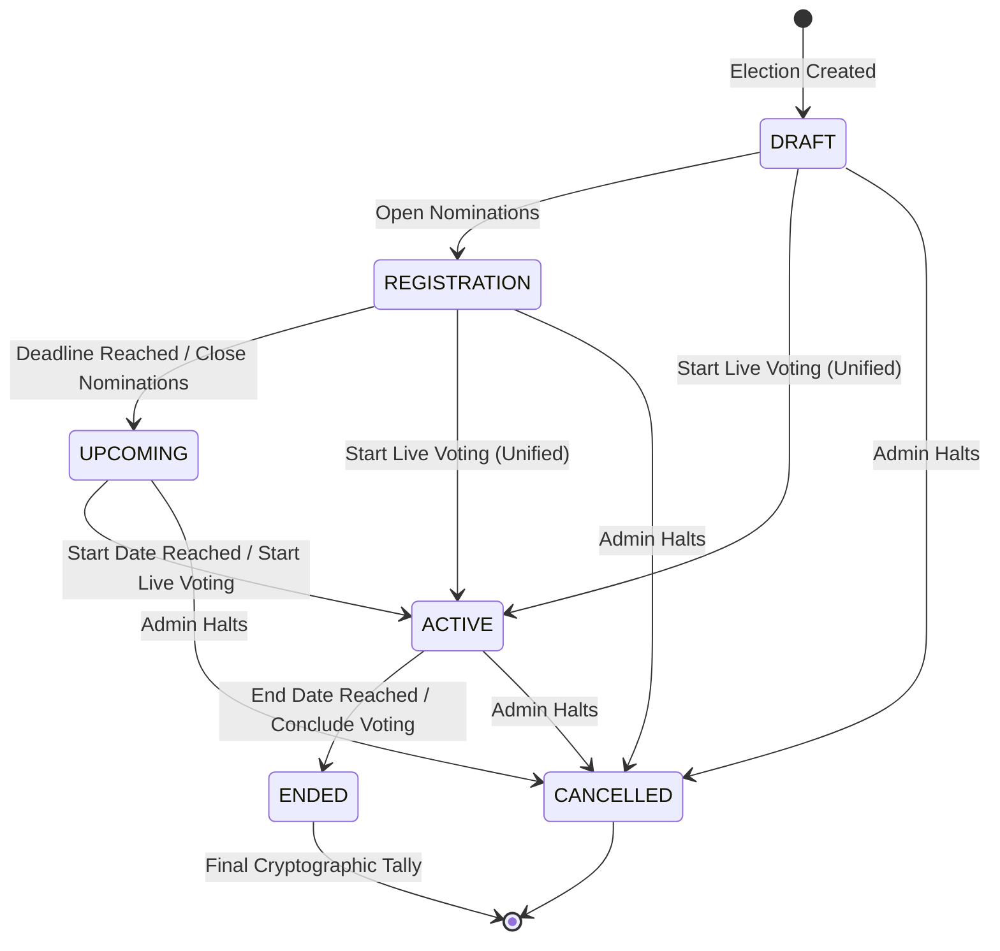
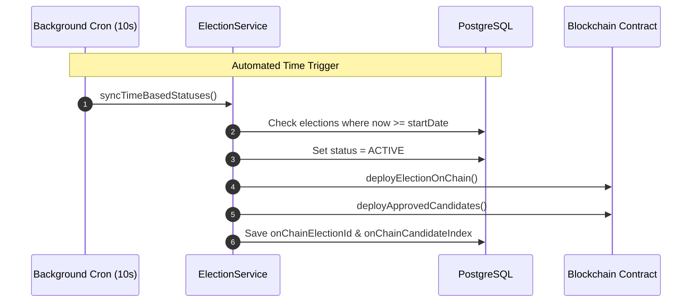

# Election Lifecycle State Machine

The platform implements a robust, dual-controlled lifecycle state machine. Transitions occur **automatically based on configured timestamps** or **manually via authorized administrative actions**.

---

## State Transition Diagram

---

## The 5 Lifecycle Stages

### 1. `DRAFT`
- Initial configuration state when an election is created.
- Administrator defines election title, description, organizational scope (Organization-Wide vs. Unit-Scoped), maximum candidate limits, and scheduled timeline (`startDate`, `endDate`, `registrationDeadline`).
- Eligibility rules can be added or adjusted.

### 2. `REGISTRATION`
- Candidate nomination window is open.
- Eligible employees can submit self-nominations with a statement and campaign slogan.
- Administrators can nominate candidates directly or review pending applications (Approve / Reject).
- Transitions to `UPCOMING` automatically when `registrationDeadline` is passed.

### 3. `UPCOMING`
- Nominations are frozen; candidate applications can no longer be submitted.
- Administrators perform final candidate audits and compute the voter roll (`computeEligibleVoters`).
- Transitions to `ACTIVE` automatically when `startDate` arrives.

### 4. `ACTIVE` (Live Voting)
- **Unified Blockchain Publishing**: When transitioning to `ACTIVE` (either automatically by timestamp or manually via the "Start Live Voting & Publish to Chain" button):
  1. The election is initialized on the smart contract (`createElection`).
  2. All approved candidates are registered on-chain with unique slot indices (`registerCandidate`).
  3. The eligible voter roll is calculated if not already completed.
- Eligible employees can now cast secret ballots.
- Any candidate approved during this phase is automatically published to the blockchain immediately.
- Transitions to `ENDED` automatically when `endDate` arrives.

### 5. `ENDED` (Concluded)
- Voting is permanently closed on both the API and smart contract levels.
- Final vote tallies are pulled directly from smart contract storage and displayed on public results dashboards.

---

## Dual Control Model: Time vs. Manual Override

The platform balances automated hands-off execution with administrative supervision:

1. **Background Scheduled Cron (`syncTimeBasedStatuses`)**: Runs every 10 seconds to check time thresholds:
   - Moves expired registration periods to `UPCOMING`.
   - Starts elections when `now >= startDate`.
   - Closes elections when `now >= endDate`.
2. **Fast Synchronous Read Updates (`fastSyncEndedElections`)**: Ensures read endpoints (`GET /elections`, `GET /my-elections`) update expired records in a single database query, eliminating any UI latency.
3. **Self-Healing Loop**: If a network delay causes a candidate deployment to fail during startup, the background scheduler detects the missing slot and re-attempts on-chain deployment automatically.

