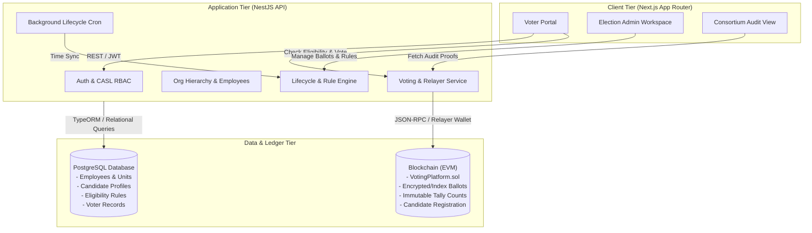

# System Overview

The Organizational Voting Platform is designed as a hybrid enterprise architecture that combines the rich relational querying of PostgreSQL with the immutability and verifiable tallying of smart contracts.

---

## Architecture Diagram

---

## Layer Responsibilities

### 1. Client Tier (Next.js 16 + React 19)
- **Role-Aware Workspaces**: Responsive portals for regular employees (Voters), Department Admins, and System Admins.
- **Dynamic Time Smoothing**: Automatically computes time-based status transitions on the client so pages update instantly without waiting for poll intervals.
- **Zustand State Store**: Manages reactive authentication, tokens, and active organization context.

### 2. Application Tier (NestJS)
- **Modular Monolith**: Divided into domain modules (`auth`, `organizations`, `employees`, `election`, `candidate`, `voting`).
- **Eligibility Engine**: Dynamic rules evaluation based on organizational unit ancestry, allowed job position IDs, and minimum tenure months.
- **Relayer Wallet Management**: Signs and submits transactions on behalf of voters so end-users never have to manage private keys or gas fees.
- **Mutex Concurrency Locking**: In-memory locks serialize relayer transactions to prevent nonce collisions during high-traffic voting or simultaneous candidate deployments.

### 3. Data & Ledger Tier
- **PostgreSQL**: Stores off-chain rich media, candidate bios, slogans, statements, and administrative audit logs.
- **Smart Contract (`VotingPlatform.sol`)**: Serves as the ultimate source of truth for vote counts and ballot receipts. Once an election ends, the cryptographic tally cannot be modified by any database administrator or server operator.

---

## Off-Chain vs. On-Chain Data Boundaries

| Data Attribute | Location | Purpose |
| :--- | :--- | :--- |
| Employee Name, Email, Position | PostgreSQL | Organizational privacy; not exposed on public chains |
| Candidate Bio, Photo, Slogan | PostgreSQL | Off-chain presentation data |
| Eligibility Rules & Logic | PostgreSQL | Complex organizational evaluation engine |
| Voter Participation Flag (`hasVoted`) | PostgreSQL | Immediate fast-path duplicate prevention |
| Election Initialization & End Timestamps | Smart Contract | Cryptographic enforcement of voting window |
| Candidate Ballot Slot Index | Smart Contract | Immutable candidate index on the blockchain |
| Raw Ballot Cast & Tally Count | Smart Contract | Unalterable, public/consortium verifiable tally |
| Transaction Hash & Receipt | Both | Linked for voter self-verification and proof of vote |

