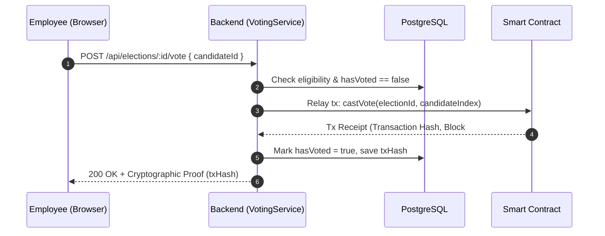

# Voting Protocol & Privacy Guarantees

Elections in an organizational setting require a strict balance between **absolute ballot secrecy** and **individual verifiability**. Employees must trust that their vote cannot be linked to their identity by managers or database administrators, while also being certain that their ballot was legitimately counted.

---

## 1. Zero-Gas Relayer Pattern

Employees do not need Web3 wallets, browser extensions (such as MetaMask), or cryptocurrency tokens to participate:



1. The voter authenticates via their corporate credentials.
2. The user selects a candidate and confirms their ballot.
3. The server's **Relayer Wallet** signs and broadcasts the on-chain transaction to the blockchain, paying the required network gas fees.
4. The smart contract validates that the candidate index exists and that the election is currently within its active start and end timestamps.
5. The transaction hash is returned to the employee as an immutable receipt.

---

## 2. One-Person, One-Vote Enforcement

To guarantee that no employee can cast more than one ballot, the platform employs a two-tier protection model:

### Database-Level Protection
- Every eligible employee has an `ElectionVoter` record with a unique constraint on `(electionId, employeeId)`.
- Upon successful submission, `hasVoted` is atomically set to `true`.
- **Non-Destructive Voter Roll Recalculation**: Even if an administrator re-computes the voter roll in the management workspace, the merge logic explicitly preserves existing `hasVoted: true`, `txHash`, and `votedAt` timestamps.

### Smart Contract Protection
- In addition to database tracking, the smart contract maintains an internal voter record to prevent relay duplication.

---

## 3. Ballot Secrecy & Verification

### Separation of Identity and Choice
- The smart contract records candidate vote increments (`votesCount[candidateId]++`).
- The database records that an employee participated (`hasVoted = true`) and stores the transaction hash for receipt generation.
- **The specific candidate choice is never associated with the employee record in PostgreSQL**. Once the relayer transaction executes, there is no database foreign key linking `Employee.id` to `Candidate.id`.

### Voter Audit Proof (`GET /api/elections/:id/verify-vote`)
Employees can verify their participation at any time by retrieving their vote proof:
```json
{
  "electionId": "87090930-c25b-4610-9f90-a9e947034b09",
  "employeeId": "d1ed37be-6554-432a-b959-fe3e6675936c",
  "hasVoted": true,
  "votedAt": "2026-10-31T15:20:00.000Z",
  "txHash": "0x5a18b...e901",
  "verifiedOnChain": true
}
```
The voter can paste this `txHash` into any public block explorer (e.g. Sepolia Etherscan) to confirm that their transaction was mined during the legal voting window.

