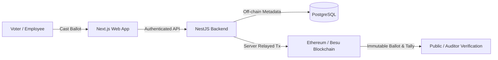

# Organizational Voting Platform

Welcome to the official technical and operational documentation for the **Organizational Voting Platform**.

The platform is an enterprise-grade digital voting solution designed to provide **provably tamper-proof, transparent elections** for organizations, corporate bodies, and consortiums while preserving strict employee ballot secrecy and strict **one-person, one-vote** guarantees.

---

## Key Platform Features

<Cards>
  <Card title="Dual-Controlled Lifecycle" href="/docs/architecture/election-lifecycle">
    Automated time-based election advancement coupled with administrative override controls for registration, review, live voting, and tally conclusion.
  </Card>
  <Card title="Blockchain Immutability" href="/docs/smart-contracts/overview">
    Every ballot and candidate registry is permanently recorded on smart contracts deployed to Hyperledger Besu or Ethereum Sepolia.
  </Card>
  <Card title="Zero-Gas Voter Experience" href="/docs/architecture/voting-protocol">
    Voters never need cryptocurrency or gas tokens; transactions are verified and relayed through a secure server relayer wallet.
  </Card>
  <Card title="Role-Based Eligibility Engine" href="/docs/guides/admin-guide">
    Granular rule engine supporting organization-wide and unit-scoped ballots with department and tenure filters.
  </Card>
</Cards>

---

## Documentation Structure

- **[Getting Started](/docs/getting-started/quickstart)**: Prerequisites, local Docker setup, database seeders, and environment variables.
- **[System Architecture](/docs/architecture/system-overview)**: Technical layers, relational vs. on-chain boundaries, and voting secrecy.
- **[Smart Contracts](/docs/smart-contracts/overview)**: Hardhat workspace, `VotingPlatform.sol` specifications, and network configurations.
- **[Administrator & Voter Guides](/docs/guides/admin-guide)**: Operational workflows for creating elections, approving candidates, and casting ballots.
- **[API Reference](/docs/api/elections)**: Interactive endpoints and DTO schemas auto-generated from backend Swagger OpenAPI specifications.
